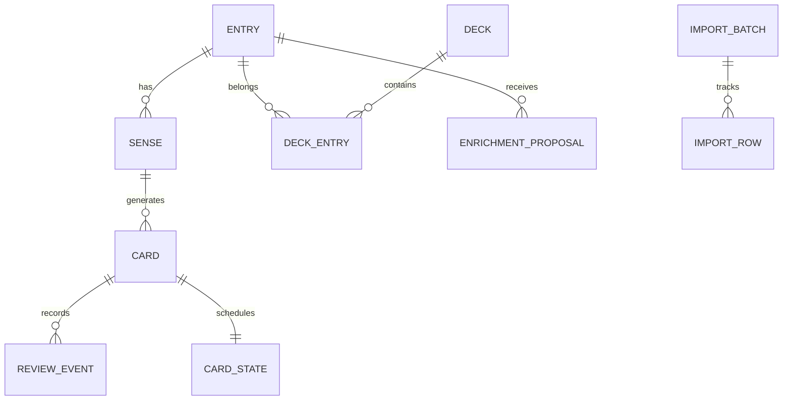

# 04 — Dữ liệu và hợp đồng import v1

## 1. Mô hình logic

| Entity | Trường chính và ràng buộc |
|---|---|
| LocalProfile | id UUID, study_timezone, source/target language mặc định, daily_new_limit |
| Entry | id UUID, term gốc, normalized_term, source_language, target_language, status, revision, created_at/updated_at UTC, deleted_at |
| Sense | id UUID, entry_id, sense_key, meaning, part_of_speech nullable, pronunciation nullable, note nullable, content_status, provenance, content_revision |
| Deck | id UUID, deck_key unique trong profile, name, description, archived_at |
| DeckEntry | deck_id + entry_id unique; một entry có nhiều sense, nhóm chứa toàn bộ sense active của entry |
| Card | id UUID, sense_id, direction, suspended; unique(sense_id, direction) |
| CardState | card_id PK, state, due_at, interval_days, lapse_count, scheduler_version, last_review_id |
| ReviewEvent | id UUID unique, card_id, rating, reviewed_at UTC, device_id, previous/new state, scheduler_version, content_revision; append-only |
| EnrichmentProposal | id, entry_id, proposed sense fields, provider/model, quality, prompt_version, generated_at, status; tách khỏi Sense đã duyệt |
| ProviderConfig | provider_id, enabled, model/deployment, endpoint, secret_ref; key nằm ngoài DB |
| ImportBatch/Row | batch id, file hash/name, schema_version, mode, row number, resolution, error, result IDs; đủ audit, không nhúng key |
| EnrichmentJob/Item | job id, entry id, input hash, trạng thái, attempts, next_retry_at, provider, result id, sanitized error |

Unique entry = profile + normalized_term + source_language + target_language. Unique sense = entry_id + sense_key. Một từ đa nghĩa có nhiều sense (`financial`, `river_edge`...), không tạo nhiều entry chỉ vì khác nghĩa. Nếu muốn một nhóm chỉ học một nghĩa của từ, cần thêm membership cấp sense ở phiên bản sau; v1 quản lý nhóm ở cấp entry.

`normalized_term`: Unicode NFC, trim, gộp khoảng trắng liên tiếp. V1 giữ phân biệt hoa/thường để không gộp `US` và `us`; cảnh báo trùng gần giống khi chỉ khác case, cho người dùng chọn hợp nhất. Không bỏ dấu, không tự stemming/lemmatize. Meaning được NFC + trim, giữ xuống dòng hợp lệ.

Trạng thái nội dung: `draft` (thiếu nghĩa) → `pending_review` → `approved`; `archived` tách khỏi trạng thái học. Từ file/API không thể tự đặt `approved`. Với nhập tay, nút “Lưu và đưa vào học” chính là hành động duyệt. Xóa/khôi phục giữ UUID; không tái tạo lịch sử mới.

## 2. Hợp đồng canonical

JSON envelope: `{ "schema_version": "1.0", "items": [...] }`. Một item là **một nghĩa của một từ trong một nhóm**. Để gắn cùng từ vào hai nhóm, dùng hai dòng cùng term/language/sense_key và khác deck_key. Metadata nghĩa phải nhất quán, nếu không thì là xung đột.

Hợp đồng máy đọc: [vocabulary-import.v1.schema.json](../schemas/vocabulary-import.v1.schema.json). Đây là schema import nội dung, không phải schema backup DB và cũng không dùng nguyên xi làm schema gọi AI.

| Trường | Bắt buộc | Kiểu / quy tắc |
|---|---|---|
| deck_key | Có | Slug ASCII thường 1–64 ký tự, `[a-z0-9][a-z0-9_-]*`; key ổn định khi đổi tên |
| deck_name | Có | String 1–120 ký tự; cùng deck_key phải cùng tên trong một file |
| term | Có | String 1–200 ký tự; có thể là cụm từ |
| source_language | Có | `en`, `vi` hoặc language tag theo pattern schema; không cho `auto` trong dữ liệu lưu |
| target_language | Có | Tương tự source; bản MVP UI học en/vi nhưng dữ liệu không hardcode |
| sense_key | Có | Slug 1–64; dùng `primary` nếu chỉ có một nghĩa |
| meaning | Không | String 1–1000 hoặc null; thiếu/null → draft, chưa được học |
| part_of_speech | Không | noun, verb, adjective, adverb, pronoun, preposition, conjunction, interjection, determiner, phrase, other hoặc null |
| pronunciation | Không | String 1–200 hoặc null; không bắt buộc IPA |
| note | Không | String 1–1000 hoặc null; không bắt buộc câu ví dụ |

Không import API key, rating, due_at hay status duyệt qua file từ vựng. Trường lạ là lỗi schema, tránh âm thầm bỏ dữ liệu. JSON không chấp nhận duplicate object keys; parser phải phát hiện trước validate.

## 3. Ánh xạ các định dạng

| Định dạng | Quy ước v1 |
|---|---|
| CSV | UTF-8, chấp nhận BOM; header đúng tên trường; dấu phẩy, quote theo CSV chuẩn; cell tùy chọn rỗng → null; không suy đoán delimiter âm thầm |
| XLSX | Excel `.xlsx` (không `.xls`/`.xlsm`); header dòng 1; sheet mặc định `vocabulary`; chọn sheet khác trước preview; cột chuẩn lưu text |
| JSON | Envelope v1, UTF-8; list items không vượt giới hạn; null có nghĩa thiếu dữ liệu |
| Parquet | Bảng phẳng cùng tên cột, string/nullable string; converter Windows đọc từng batch, xuất envelope JSON v1 và báo lỗi theo row; chưa hỗ trợ struct/list/binary hoặc đọc trực tiếp Android |

CSV/XLSX/Parquet chọn schema v1 trong importer/converter vì không có envelope. Không đặt số hoặc boolean vào trường text rồi tự coercion không báo. XLSX không thực thi công thức/macro; ô công thức thuộc cột dữ liệu là lỗi, yêu cầu paste values. Ignore hàng hoàn toàn trống, không ignore hàng chỉ thiếu một số cột. Ô meaning chứa dấu phẩy/xuống dòng phải quote đúng trong CSV.

Giới hạn đề xuất cho MVP: file đầu vào tối đa 20 MiB, 10.000 dòng dữ liệu, 10 cột schema; XLSX giới hạn tổng giải nén 100 MiB và số ô trước khi đọc; Parquet giới hạn cả số dòng/decoded bytes, không chỉ file nén. Đọc có thể hủy và không chạy nặng trên UI thread. Giới hạn được xác nhận bằng spike Android; lỗi vượt giới hạn hướng dẫn chia file, không gọi AI.

Ví dụ CSV và JSON trong `examples/` có cùng dữ liệu: `retain`, `bank/financial`, `bank/river_edge`, và `resilient` chưa có nghĩa. XLSX có thể tạo bằng các cột CSV tương ứng; khi implementation sẽ phát hành template XLSX và utility Parquet thực tế. Bộ kickoff chưa bao gồm binary mẫu XLSX/Parquet.

## 4. Pipeline và chống trùng

1. Kiểm kiểu file/giới hạn/schema version; parse an toàn.
2. Canonicalize theo quy tắc trên; validate từng dòng bằng schema và quy tắc ngữ nghĩa.
3. So sánh trong file và DB theo entry key + sense_key + deck_key.
4. Preview phân loại: mới; membership mới; trùng giống hệt; xung đột; không hợp lệ.
5. Người dùng xử lý xung đột hoặc chọn bỏ qua; chỉ sau đó commit một transaction.

**Chế độ mặc định:** thêm mới và membership mới; không ghi đè sense đã có. Nếu cùng key nhưng nội dung khác, đưa vào conflict, không âm thầm skip như trùng giống hệt. Có thể chọn “Cập nhật các mục đã chọn”; preview từng field. Null/field bị thiếu không xóa giá trị đang có; muốn xóa trường thực hiện trong editor, tránh file thiếu cột làm mất nội dung.

**Trùng trong file:** dữ liệu nghĩa giống hệt thì gộp, membership khác thì thêm; cùng key nghĩa khác nhau báo conflict và yêu cầu chọn dòng. Cùng deck_key mà tên khác cũng là conflict. Đổi term/ngôn ngữ/sense_key qua file được coi là identity mới; dùng editor cho rename để giữ lịch sử, không suy đoán bằng meaning.

**Lịch ôn:** import thêm nhóm/nhập lại không reset card; cập nhật nghĩa đã duyệt phải qua review và lựa chọn reset như UC05. Sense có đề xuất cập nhật vẫn giữ nội dung approved hiện tại cho đến khi duyệt. File hash hỗ trợ audit, không phải chìa khóa chống trùng duy nhất.

**Báo cáo lỗi:** batch_id, row_number, field, code, message và giá trị rút gọn. Không ghi toàn bộ prompt/key. Xuất CSV báo lỗi/CSV dữ liệu phải vô hiệu hóa formula injection ở cell bắt đầu `=`, `+`, `-`, `@`; JSON là lựa chọn xuất không biến đổi chuỗi gốc.

## 5. Backup khác với import

Backup có `backup_format_version`, `db_schema_version`, app version, library/profile id, created_at, file hashes và snapshot nhất quán. Chứa toàn bộ ID, membership, nghĩa đã duyệt, review events, schedule, jobs cần phục hồi, settings không bí mật. Không kèm cache HTTP/API keys. Restore vào DB tạm, validate FK và version, rồi đổi DB atomically sau khi đóng kết nối; không ghi đè DB đang mở. Backup có thể chứa nội dung cá nhân; mặc định lưu local, mã hóa archive là tính năng bổ sung trước cloud backup.

## 6. Mở rộng passage — kickoff v0.2

Bổ sung PassageJob và provenance mức ước lượng trên proposal/sense theo [tài liệu 08](08-passage-extraction.md). Response LLM compact có schema riêng, cần adapter để vào thư viện hoặc xuất import v1. Import v1 giữ nguyên và không mang level/provenance; backup mở rộng phải giữ metadata này cùng passage còn lưu.

## 7. Triển khai backup từ 0.2

[Hợp đồng backup đang dùng](12-releases-and-backups.md) là JSON snapshot có checksum, version DB/format và transaction restore; không phải schema import từ vựng. Bản 0.2 kiểm FK/state và rollback trong DB đang mở, có recovery snapshot, thay cho cơ chế staging/swap file dự kiến ở mục 5.
