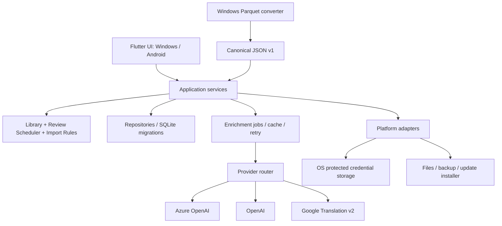

# 05 — Kiến trúc và phát hành

## 1. Quyết định đề xuất

**Flutter/Dart + SQLite, offline trước; chưa cần backend ở MVP.** Cùng domain học/import cho Windows và Android, UI responsive. Flutter hỗ trợ cả hai nền tảng theo [tài liệu deployment platforms](https://docs.flutter.dev/reference/supported-platforms); khả năng của từng plugin và bản OS thực tế phải qua M0.

| Phương án | Điểm phù hợp | Chi phí/rủi ro | Quyết định |
|---|---|---|---|
| Giữ Python/PySide6 của dự án 1 | Tận dụng desktop và kiến thức hiện có | Chưa có pipeline Android đã kiểm chứng trong repo; mobile cần spike riêng | Không chọn mặc định cho mục tiêu hai nền tảng |
| Flutter/Dart | Một UI/domain cho Windows + Android; layout thích nghi | Cần port adapter; SQLite, secure storage, XLSX/installer cần thử | Đề xuất |
| Hai app native độc lập | Chủ động tích hợp OS | Hai UI và hai vòng kiểm thử/domain dễ lệch | Chưa phù hợp quy mô cá nhân |

Không khóa dependency package ở BA. M0 chọn và pin package sau khi kiểm tra Windows/Android, license và build release. Có thể dùng Python cho converter Parquet riêng, không đóng gói Python runtime vào app Android.

## 2. Các khối

Dependency đi từ UI → application → domain; domain không import Flutter widgets/network. `VocabularyRepository`, `ReviewRepository`, `EnrichmentProvider`, `TranslationProvider`, `Scheduler`, `BackupService`, `UpdateService` là interface. Thêm provider mới không sửa màn hình học. Plugin Python động của dự án 1 không được kế thừa nguyên trạng; v1 adapter build cùng binary, bật/tắt bằng settings.

## 3. Contract API và chất lượng nội dung

Request enrichment: request_id, term, source_language, target_language, optional user note, requested_fields, prompt_version. Với enrichment từng từ, chỉ gửi những từ người dùng đã chọn; không gửi toàn bộ DB hoặc lịch sử học.

Response nội bộ: entry reference, proposals[{sense_key, meaning, part_of_speech?, pronunciation?}], provider, model/deployment, quality (`ai_generated` / `translation_only`), generated_at, request_id. `sense_key` từ model phải qua quy tắc chống trùng và duyệt; không coi là ID đáng tin để ghi đè sense cũ.

Khi model hỗ trợ, dùng structured output với schema riêng đơn giản theo subset nhà cung cấp; luôn validate lại và xử lý refusal/truncation. [OpenAI Structured Outputs](https://developers.openai.com/api/docs/guides/structured-outputs) ràng buộc cấu trúc, không xác nhận tính đúng của nghĩa. Không dùng JSON Schema import có metadata nhóm làm prompt output một cách máy móc.

Google Cloud Translation dùng adapter riêng: dịch plain text, decode escaping theo contract, map vào một meaning tạm; không gán POS/IPA/sense phân biệt nếu response không có. Đây là khả năng dịch văn bản của [Cloud Translation](https://docs.cloud.google.com/translate/docs/translate-text), không phải từ điển đa nghĩa.

## 4. Chính sách provider và lỗi

Thứ tự mặc định đề xuất: **Azure OpenAI → OpenAI → Google Translation → giữ nháp/nhập tay**. Người dùng có thể đổi ưu tiên và bật/tắt fallback; chỉ gọi provider đã bật và đủ cấu hình. Hiện provider thực tế ở kết quả. Mỗi provider dùng credential riêng, không tráo key giữa host.

| Lỗi | Hành vi |
|---|---|
| Chưa cấu hình | Bỏ qua provider; báo ở Settings; không gửi request vô ích |
| 401/403 | Không retry cùng key; đánh dấu cần sửa cấu hình; chuyển provider được bật |
| 429/tạm thời, 5xx, timeout | Tối đa 2 retry sau lần đầu, exponential backoff + jitter; tôn trọng Retry-After; nếu vượt deadline thì giữ pending hoặc fallback |
| Hết quota/budget local | Không retry; budget local là chặn toàn job, không đổi provider để vượt giới hạn |
| Output sai schema/truncated | Một lần sửa có kiểm soát trong ngân sách; vẫn lỗi thì fallback, không lưu nội dung học |
| Refusal/chặn nội dung | Dừng mục đó, để sửa tay; không tự chuyển provider để vượt chặn |
| Sai input hoặc request 400 | Hiện lỗi cấu hình/dữ liệu; không retry vô hạn |
| Cancel | Dừng enqueue/request khi hỗ trợ; không fallback; response đến muộn không tự commit vào thư viện |
| Mất mạng toàn máy | Giữ job pending, tiếp tục phần học offline; không quét tuần tự mọi provider |

Đề xuất timeout mỗi attempt 30s, tổng xử lý online một item 120s, concurrency 2, mặc định tối đa 100 từ/job, tối đa 300 request/job gồm retry và fallback. Đây là cấu hình thử ban đầu, sẽ chỉnh theo quota và latency thực tế. Kết thúc budget giữ phần chưa làm pending. Không tự chạy hàng nghìn từ chỉ vì vừa import.

Cache key = normalized input + ngôn ngữ + provider + model/deployment + prompt_version + schema_version; TTL 30 ngày là mặc định đề xuất, có nút tạo lại. Proposal đã duyệt tồn tại trong thư viện độc lập TTL. Không cache lỗi auth; job resume chỉ gọi lại mục chưa có kết quả. API bên ngoài có thể đã tính phí nếu app timeout trước khi nhận response; chỉ đảm bảo không ghi DB trùng, không hứa exactly-once billing.

Hiện số request/tokens/characters theo dữ liệu provider trả về; nếu thiếu usage ghi “không xác định”. Chi phí tiền chỉ là ước tính khi có bảng giá do người dùng cấu hình, không hardcode giá hiện hành. Đặt quota/budget ở tài khoản cloud bổ sung cho giới hạn trong app.

## 5. Credential và kết nối

BYOK cho app cá nhân: nhập key trên từng thiết bị, lưu bằng kho bí mật hệ điều hành qua platform adapter được kiểm chứng. Không để trong SQLite/settings plaintext, log, backup hay source. Nếu secure storage không khả dụng: dùng key chỉ trong phiên hoặc yêu cầu cấu hình lại, không âm thầm hạ xuống plaintext.

Endpoint Azure phải HTTPS, do chủ thiết bị cấu hình; key chỉ gửi đến host đã lưu cho provider đó, không forward authorization qua redirect sang host khác. Test connection có thể phát sinh request/chi phí, UI nói rõ trước khi chạy. Không thử key thật trong kickoff.

Khi phát hành cho nhiều người với key do chủ app trả tiền: thêm backend gateway có auth, secret phía server, quota và audit. Không nhúng shared secret vào APK/EXE. Đây là thay đổi mô hình vận hành, không cần cho BYOK cá nhân hiện tại.

## 6. Đa thiết bị

**MVP:** mỗi máy có DB độc lập; backup/restore để chuyển thư viện và tiến độ, chọn một máy chính giữa các lần chuyển. Hai thiết bị cùng học sẽ tạo hai nhánh dữ liệu không tự merge.

**Milestone sync riêng:** UUID/device_id từ đầu, review events append-only; outbox local, push/pull idempotent qua server có auth/TLS; checkpoint và tombstone cho delete; metadata có revision/conflict. Không đồng bộ bằng ghi đè nguyên file SQLite đang mở.

Khi hai máy cùng review một card, giữ cả event nhưng cần quyết định quy tắc replay/sắp thứ tự trước khi triển khai: server sequence + thời gian client, xử lý lệch đồng hồ và event bị trùng. Không hứa “last write wins” cho schedule vì có thể mất lượt ôn. Nội dung sửa đồng thời có conflict UI; key không sync. Sync thiết kế xong và qua UAT mới được coi là cùng một thư viện trên hai máy.

## 7. Build và update

Target đề xuất kiểm thử đầu: Windows 11 x64, một điện thoại Android arm64 Android 10+; đây là support matrix của sản phẩm dự kiến, không phải minimum toàn bộ Flutter. Chốt theo máy thật và plugin ở M0.

- Windows build trên Windows runner/máy Windows với toolchain phù hợp, đóng Inno Setup hoặc phương án tương đương sau spike. Không xem test WSL là test installer Windows.
- Android build release APK và ký; giữ applicationId và signing key ổn định, versionCode tăng. Quy trình Flutter có hướng dẫn [build và ký APK](https://docs.flutter.dev/deployment/android). Người dùng cho phép cài từ nguồn đã chọn và xác nhận qua trình cài hệ thống; không hứa cập nhật im lặng như Windows.
- CI: lint/unit/contract tests → build Windows và Android → package → smoke trên thiết bị → phát hành artifacts + release notes + checksums. Chưa tạo repo remote/tag/release trong kickoff.
- Manifest đề xuất: version, channel stable/beta, platform/arch, min_supported_version, download_url, sha256, notes_url, db_schema_version. Chọn nguồn HTTPS do chủ app kiểm soát; xác minh authenticity của gói/manifest khi triển khai, checksum không thay chữ ký.
- App chỉ thông báo bản mới, người dùng chọn tải/cài khi kết thúc phiên; không mất tiến độ nếu từ chối. Version app, schema import, schema DB và scheduler là bốn version khác nhau.
- Trước migration tạo snapshot; migration transaction. Không auto downgrade binary rồi mở DB mới. Rollback cần binary tương thích + backup trước nâng cấp, nêu rõ có thể mất dữ liệu phát sinh sau snapshot.

Kế thừa trải nghiệm dự án 1 nhưng viết updater theo Flutter/platform. Android package signature, Windows code-signing certificate và cách phát hành manifest được chốt trước public distribution; internal alpha vẫn cần ghi rõ trạng thái ký của Windows.

## 8. Passage extraction — kickoff v0.2

Thêm PassageExtractionService dùng LLM adapter và contract JSON riêng, không gọi API theo từng từ sau extraction. PassageJob có cache/input-output budget riêng: tối đa 3 attempts/job và deadline 120s, thay cho giới hạn batch enrichment ở mục 4. Chỉ Azure/OpenAI dự phòng cho capability này; Google không có vai trò phân mức. Request, validation, mapping và xử lý nguồn tại [tài liệu 08](08-passage-extraction.md).
